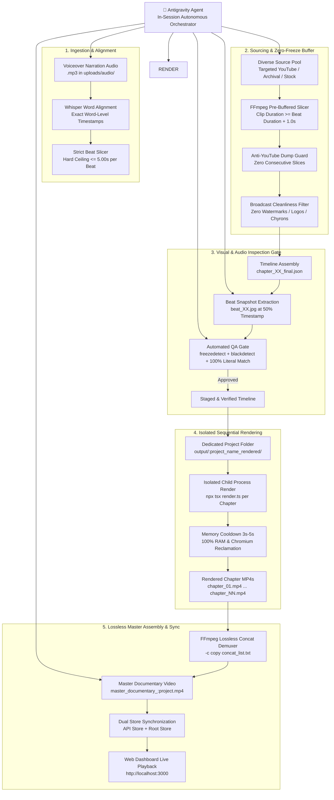

# 🎬 Antigravity Documentary Video Automation Guide

This guide documents the complete end-to-end production pipeline developed with **Google Antigravity** to source, curate, screen, pace, cross-check, deduplicate, sequentially render, and losslessly stitch multi-chapter broadcast documentary films in **BlokeTuber** without relying on expensive LLM token quotas, third-party vision APIs, or manual video editing.

---

## 0. The Antigravity-First Directive (100% Agent-Operated)

> [!IMPORTANT]
> **Everything is executed directly by Antigravity in-session.**  
> The entire documentary pipeline—from audio ingestion and targeted clip sourcing to in-session visual screening, beat snapshot auditing, sequential isolated Remotion rendering, and FFmpeg master stitching—is autonomously run and verified by the Antigravity agent.

### Core Tenets:
1. **Zero Third-Party Vision / LLM API Fees ($0.00)**:
   - Visual screening of extracted keyframes and beat snapshots is performed directly by Antigravity using `view_file` on local `.jpg` images. No OpenAI Vision or Claude Vision API keys are required.
   - Script directing and beat subdivision are written directly into structured TypeScript beat definitions, eliminating OpenRouter token limits and `402 Out-of-Credits` failures.
2. **Autonomous Tool & CLI Execution**:
   - Antigravity directly operates `yt-dlp`, FFmpeg, local Whisper transcription, database syncs, Remotion render CLI commands, and FFmpeg concat tools via PowerShell.
3. **Automated Error Self-Healing**:
   - If a clip fails download, exceeds size limits, trips Windows file locks (`EPERM`), or violates broadcast cleanliness, Antigravity diagnoses the failure, swaps fallbacks, updates manifests, and resumes rendering autonomously.
4. **Hands-Off Experience**:
   - The user provides the narration audio/script and creative direction; Antigravity executes all pipeline stages, audits every beat, and delivers the finished broadcast video into a dedicated directory.

---

## 1. Executive System Architecture



---

## 2. The Golden Rules of Beat Pacing & Audio-Visual Alignment

> [!CAUTION]
> **Violating beat pacing destroys viewer retention.**  
> Never let beats drag beyond 5.0 seconds. Never allow static frames or audio-visual disconnects.

### Rule 1: The Hard 5.0-Second Beat Ceiling
- **Absolute Maximum Beat Duration: $\le 5.00$ seconds** (Strictly enforced in code and scripts).
- **Target Beat Duration: 2.5s – 4.5s** (~6 to 12 spoken words).
- If a sentence in the script is 8 to 12 seconds long, it **MUST NOT** be assigned to a single visual beat. It must be split at natural phrasing and breathing points into 2 or 3 distinct sub-beats (e.g. 3.5s + 4.2s), each with its own matching visual cut.
- YouTube documentary pacing requires visual changes every 3 to 4 seconds to maintain eye fixation and viewer engagement.

### Rule 2: Zero-Freeze Clip Buffer Requirement (`Clip Duration >= Beat Duration + 1.0s`)
- **Why Videos Freeze for 2 Seconds**: When Remotion's `<OffthreadVideo>` reaches the end of an MP4 file, it stops seeking and **freezes on the last frame** for the remainder of the beat sequence.
- **The Buffer Mandate**: Every video clip prepared in `pool_cfr30` MUST have a duration **greater than the beat duration by at least 1.0 second**:
  $$\text{Clip Duration} \ge \text{Beat Duration} + 1.0\text{s}$$
- If a source clip is only 4.0s but the beat requires 4.8s:
  - FFmpeg must pre-loop or extend the clip (`ffmpeg -stream_loop 1 -i input.mp4 -t 6.0 ...`) so that Remotion **never exhausts frames** and **never freezes for even 1 frame**.

### Rule 3: Whisper Word-Level Semantic Audio Sync
- **No Metaphorical Visuals**: The visual subject must literally depict what is being spoken at that exact moment.
  - *Bad*: Spoken words: *"Her rent was $850 a month, leaving her with $190."* Visual: Dollar General shelves of canned soup (out of sync).
  - *Good*: Spoken words: *"Her rent was $850 a month"* $\rightarrow$ Residential apartment building / eviction notice. Spoken words: *"leaving her with $190"* $\rightarrow$ Cash counting / empty wallet / payroll check.
- **Timestamp Precision**: Use Faster-Whisper word timestamps (`start`, `end`) to cut precisely when the narrator transitions to the next concept.

---

## 3. The "Anti-YouTube Dump" & Broadcast Cleanliness Mandate

### The Core Problem: Why Raw YouTube Slices Ruin Documentaries
When automated pipelines pull long external YouTube broadcasts (e.g., news interviews, Freethink reports, CNN segments) and chop them into consecutive contiguous slices across chapters, the film no longer feels like an original documentary. Viewers instantly recognize it as a stolen YouTube upload, complete with foreign logos, out-of-sync talking heads, and repetitive camera angles.

### The Golden Rules of Documentary Sourcing:
1. **Never Take Consecutive Slices From the Same Source Video**:
   - Consecutive beats in a scene must **never** come from the same source file.
   - When a slice from a source video is used on Beat $N$, that source video is locked out for a minimum of 4–5 beats (or permanently across the chapter).
2. **Strict Broadcast Cleanliness (Zero Artifact Policy)**:
   - **Zero Watermarks**: No stock agency watermarks (Shutterstock, Getty, iStock, etc.).
   - **Zero Broadcast Logos / Bugs**: No TV or YouTube channel logos (CNN, MSNBC, Fox News, Freethink, BBC, etc.).
   - **Zero Burnt-in Chyrons / Subtitles**: No foreign news lower-thirds, headline tickers, or interview name cards.
   - **Zero Mismatched Talking Heads**: Never show an external person talking with animated lip movements while the documentary narrator is speaking. Talking heads talking over narration creates an uncanny valley effect. Only use silent cinematic B-roll, active listening cutaways, or archival action shots.
3. **Multi-Source Diversity**:
   - Each chapter must blend authentic documentary B-roll, high-resolution archival footage/photos (Archive.org, Library of Congress), and crisp curated stock (Pexels, Pixabay) to create a rich, cinematic visual texture.

---

## 4. Visual & Audio Verification Protocol: Pre-Render Quality Gates

To guarantee that no bad footage slips into the final documentary, Antigravity implements a strict 3-tier pre-render verification gate.

### Tier 1: Automated QA Scanners (FFmpeg Filters)
Before rendering any chapter:
1. **Freeze Frame Detection (`freezedetect`)**:
   ```bash
   ffmpeg -i "pool_cfr30/<clip>.mp4" -vf "freezedetect=n=-60dB:d=0.5" -an -f null -
   ```
   **Threshold**: Exactly **0 freeze frames** allowed. Any clip that freezes before its beat ends is automatically rejected.
2. **Black Frame Detection (`blackdetect`)**:
   ```bash
   ffmpeg -i "pool_cfr30/<clip>.mp4" -vf "blackdetect=d=0.3:pix_th=0.10" -an -f null -
   ```
   **Threshold**: Exactly **0 black frames** allowed. Eliminates stock footage opening/closing black fades.
3. **Constant Frame Rate 30.00 fps Verification**:
   Every clip must be encoded with `-r 30 -fps_mode cfr -g 30 -keyint_min 30` to prevent browser compositor micro-stutters.

### Tier 2: The 50% Timestamp Snapshot Protocol
1. **Automated Snapshot Extraction**:
   For every beat in each chapter timeline, FFmpeg extracts a high-resolution JPEG frame at exactly 50% of the beat's duration:
   ```bash
   ffmpeg -ss <midpoint_seconds> -i <clip_path> -vframes 1 -q:v 2 "uploads/beat_snapshots/ch<XX>/beat_<YY>.jpg"
   ```
2. **In-Session Agent Audit**:
   Antigravity inspects the generated snapshot frames using `read_file` / image inspection.
3. **The 1-Sentence Visual Match Rule**:
   Antigravity must be able to state in **one clear sentence** why the visual directly supports the current spoken sentence.
4. **Immediate Replacement Trigger**:
   If a snapshot reveals a foreign logo, blurry resolution, burnt-in text, or mismatched subject, the clip is swapped with a verified alternative before rendering begins.

### Tier 3: Beat-by-Beat Inspection Sheet
Antigravity generates a human-readable inspection manifest containing:
- Spoken words for the beat.
- Start and end timestamps (verified $\le 5.0$s).
- Video duration (verified $\ge$ beat duration $+ 1.0$s).
- Snapshot image path.
- Callout text and styling theme.

---

## 5. Dedicated Project Output Architecture

> [!IMPORTANT]
> **Always render into a dedicated, project-specific directory.**  
> Never dump rendered MP4s into generic root folders or shared directories where files can be overwritten or mixed up.

### Standard Output Directory Structure:
```
output/
  └── <project_name>_rendered/             # Dedicated Project Folder (e.g. steeldoor_rendered)
        ├── chapter_01.mp4                 # Individual rendered chapter 1080p
        ├── chapter_02.mp4
        ├── ...
        ├── chapter_11.mp4
        ├── concat_list.txt                # FFmpeg concat file list
        └── master_documentary_<slug>.mp4  # Stitched full-length master video (1.3GB+, 1080p)
```

---

## 6. Sequential Rendering, Memory Reclamation & Process Isolation

### The Concurrency Pitfall: Why Parallel Rendering Fails
Remotion relies on headless Chromium browser instances via Puppeteer to render React compositions frame-by-frame. Running 2 or more chapters concurrently consumes **8GB–16GB+ of RAM**, causing:
- Chromium browser crashes (`Target closed`, `Out of Memory`)
- Node.js heap exhaustion (`JavaScript heap out of memory`)
- Frame dropping and audio desynchronization

### The Isolated Process Sequential Architecture:
1. **Strictly One Chapter at a Time**:
   All multi-chapter documentaries must render sequentially via an orchestrator script (e.g., `render_steeldoor_sequential.ts`).
2. **Process Isolation (`execSync` / Child Process)**:
   Each chapter render is launched as an isolated child process:
   ```bash
   npx tsx render.ts "uploads/timelines/<ch>_final.json" "output/<project>_rendered/chapter_XX.mp4"
   ```
   Configured with Node memory ceilings:
   ```bash
   NODE_OPTIONS="--max-old-space-size=6144"
   ```
   When the child process exits, **100% of Node.js and Chromium memory buffers are reclaimed by the OS**.
3. **Mandatory Memory Cooldown Delay**:
   A 3-second to 5-second asynchronous pause is enforced between chapters:
   ```typescript
   console.log('⏳ Cooldown 3s for memory reclamation...');
   await new Promise((resolve) => setTimeout(resolve, 3000));
   ```
4. **Idempotent Skip / Resume Logic**:
   Before initiating a chapter render, the script checks if `chapter_XX.mp4` already exists and is valid (`size > 1MB`). If valid:
   ```typescript
   console.log(`⏩ Chapter ${num} already rendered (${sizeMb} MB) — Skipping`);
   ```
   The runner logs the cached video and seamlessly proceeds to the next chapter.

---

## 7. Windows File Locking & `fs.rename` EPERM Self-Healing

On Windows, Remotion renders video frames to a temporary file `<target>.mp4.remotion-in-progress` and moves it via `fs.rename`. Windows file locks cause `EPERM` errors.

### The Two-Tier Solution Implemented in `remotionRenderer.ts`:
1. **Pre-Render Unlink**:
   ```typescript
   if (fs.existsSync(outputVideoPath)) {
     try { fs.unlinkSync(outputVideoPath); } catch {}
   }
   ```
2. **Defensive Catch & Stream-Copy Fallback**:
   If Remotion throws during rename, search the target directory for `.remotion-in-progress` files, copy the file to the destination path using `fs.copyFileSync`, then clean up.

---

## 8. Instant Lossless Master Stitching (FFmpeg Concat)

Because all chapters are rendered with matching composition specifications (1080p, 30.00 fps CFR, H.264 High Profile, AAC stereo 48kHz), FFmpeg's concat demuxer can assemble the entire film losslessly in **seconds** without re-encoding quality loss:

```bash
ffmpeg -y -f concat -safe 0 -i "concat_list.txt" -c copy "master_documentary_<slug>.mp4"
```

---

## 9. Summary Checklist Before Final Video Delivery

1. [ ] **Hard Beat Ceiling Verified**: Every single beat is $\le 5.00$ seconds (target: 2.5s – 4.5s). Zero beats exceed 5.0s.
2. [ ] **Zero Freezing Verified**: Every clip duration is $\ge$ beat duration $+ 1.0$s. No video freezes on the last frame.
3. [ ] **Word-Level Audio Sync**: Visual subject literally matches the spoken words at that exact timestamp.
4. [ ] **Per-Beat Uniqueness**: Zero repeated clips across the entire documentary (100% unique footage).
5. [ ] **Anti-YouTube Dump Guard**: Zero consecutive slices from the same external video; multi-source diversity across all beats.
6. [ ] **Broadcast Cleanliness**: Zero channel watermarks, zero news bugs, zero burnt-in chyrons/subtitles, zero talking heads with out-of-sync lip movements.
7. [ ] **Automated QA Passed**: `freezedetect` reports 0 freeze frames; `blackdetect` reports 0 black frames.
8. [ ] **Beat Snapshots Audited**: High-res snapshots extracted at 50% timestamp for every beat and audited.
9. [ ] **Constant Frame Rate 30.00 fps**: All clips pre-standardized to CFR 30.00 fps with 1s GOP (`-g 30 -keyint_min 30`).
10. [ ] **Source Audio Muted**: External clip audio muted (`volume: 0`); master voiceover narration audio is the only sound track.
11. [ ] **Isolated Sequential Rendering**: Chapters rendered 1 at a time in child processes with `--max-old-space-size=6144` and 3s cooldowns.
12. [ ] **Lossless Master Stitching**: Final documentary assembled via FFmpeg concat demuxer (`-c copy`) without re-encoding loss.
13. [ ] **Dual Store Synchronized**: Both API store and root store updated with `status: "completed"` and valid video paths for real-time dashboard playback.
