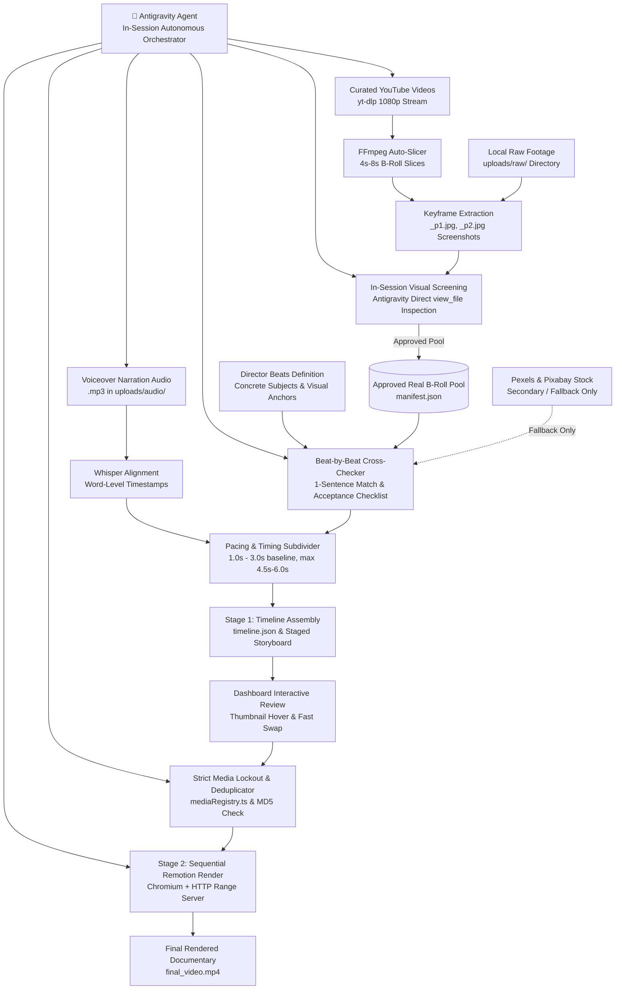

# 🎬 Antigravity Documentary Video Automation Guide

This guide documents the complete end-to-end workflow developed with **Google Antigravity** to source, screen, pace, cross-check, deduplicate, and render multi-chapter documentary films in **BlokeTuber** without relying on expensive LLM token quotas, third-party vision APIs, or manual editing steps.

---

## 0. The Antigravity-First Directive (100% Agent-Operated)

> [!IMPORTANT]
> **Everything is executed directly by Antigravity in-session.**  
> The entire documentary pipeline—from audio ingestion and YouTube clip sourcing to in-session visual screening, beat cross-checking, deduplication, and sequential Remotion rendering—is autonomously run and verified by the Antigravity agent.

### Core Tenets:
1. **Zero Third-Party Vision / LLM API Fees ($0.00)**:
   - Visual screening of extracted keyframes is performed directly by Antigravity using `view_file` on local `.jpg` screenshots. No OpenAI Vision or Claude Vision API keys are required.
   - Script directing and beat subdivision are written directly into structured TypeScript beat definitions, eliminating OpenRouter token limits and `402 Out-of-Credits` failures.
2. **Autonomous Tool & CLI Execution**:
   - Antigravity directly operates `yt-dlp`, FFmpeg, local Whisper transcription, database syncs, and Remotion render CLI commands via the terminal.
3. **Automated Error Self-Healing**:
   - If a clip fails download, exceeds size limits, or violates pacing rules, Antigravity diagnoses the failure, swaps fallbacks, updates manifests, and resumes rendering autonomously.
4. **Hands-Off Experience**:
   - The user provides the narration audio/script and creative direction; Antigravity executes all pipeline stages, cross-checks every beat, and delivers the finished broadcast video.

---

## 1. Executive Architecture



---

## 2. Priority Rule: Authentic YouTube B-Roll Over Generic Stock

### Why Real YouTube Footage Takes Priority
- **Documentary Authenticity**: Generic commercial stock footage (e.g. smiling corporate models, staged handshakes) immediately breaks documentary immersion.
- **Specific Human Context**: Real YouTube documentary footage provides genuine textures, period-accurate vehicles, authentic working-class environments, and geographically accurate landscapes.
- **Stock Footage is Strictly Fallback**: Pexels and Pixabay are used only when no relevant YouTube or local footage exists for a specific visual concept.
- **Archive / Stock Allowed When More Relevant**: Archive.org, Pexels, Pixabay, and other usable sources may be used when they provide a stronger beat-level match than available YouTube or local footage.
- **Images Are Acceptable When They Match Better**: A strong still image, archival photo, document scan, or relevant real-world photograph is better than a weak or generic moving clip.
- **Avoid Generic People Footage**: For homelessness, housing insecurity, shelters, encampments, street survival, outreach, or poverty-related narration, source specific homeless people / shelter / encampment / street-life visuals instead of generic people, office workers, staged models, or unrelated crowd shots.

### Sourcing & Ingestion Pipeline
1. **Targeted YouTube Sourcing**:
   - Source specific search topics or user-provided URLs matching the narration (e.g., *"desert highway camper van documentary"*, *"Renton Washington modular shelter"*).
   - Use `yt-dlp` ([`youtubeSourcing.ts`](file:///C:/Users/karth/Documents/BlokeTuber/apps/api/src/services/youtubeSourcing.ts)) to download top-quality 1080p MP4s.
   - If the available YouTube/local footage does not match a beat closely enough, search Archive.org, Pexels, Pixabay, or another usable source for a more relevant clip or still image.
   - For homelessness-related beats, search specifically for shelter, encampment, street survival, outreach, eviction, and visibly unhoused-context visuals before accepting generic people footage.
2. **Automatic Clip Slicing**:
   - FFmpeg slices long videos into usable 4.0s–8.0s narrative B-roll clips.
3. **Keyframe Screenshot Extraction**:
   - For every sliced clip, two keyframes (`_p1.jpg` at 25% and `_p2.jpg` at 75% duration) are extracted into `uploads/raw/:projectId/screenshots/`.
4. **Muted Audio Guarantee**:
   - All external audio from YouTube and raw clips is muted (`volume: 0`) in Remotion. The voiceover narration is the sole audio track.

---

## 3. Beat-by-Beat Visual Cross-Checking & Quality Gate

Every single beat must be rigorously cross-checked by Antigravity before being placed into `timeline.json`.

### The 1-Sentence Visual Match Rule
> **Rule**: When evaluating a candidate clip screenshot against a narration beat, Antigravity must be able to state in **one clear sentence** why the visual directly supports the current spoken sentence. If the visual relationship cannot be clearly justified, the clip **must be rejected** and replaced.

### Per-Beat Uniqueness Rule
> **Rule**: Every beat must use a unique visual asset or unique source segment. No clip, still image, source URL, filename, or MD5-identical file may repeat anywhere in the same chapter or across the full project.

### Clip Acceptance Checklist
Approve a candidate clip only if **all** the following criteria pass:

| Check | Requirement | Auto-Reject Trigger |
|---|---|---|
| **Subject & Demographic** | Visual matches the specific age, gender, role, and appearance described. | Young person when narration describes an elderly retiree; corporate attire when describing a tradesman. |
| **Action & State** | The physical action depicted directly supports the narration line. | Sleeping when narration talks about driving; partying when discussing isolation. |
| **Geography & Setting** | Correct location, climate, and architecture (US locations for US stories). | Tropical palm trees or European road signs in an Oregon or Midwest story. |
| **Era Fidelity** | Technology, vehicles, clothing, and interiors fit the time period. | Modern smartphones or 2024 electric cars in a 1990s retro story. |
| **Broadcast Cleanliness** | Clean cinematic b-roll with zero overlay artifacts. | Channel watermarks, news tickers, camera shakes, or talking-head interview busts. |
| **Audio Independence** | Visual must make complete, coherent sense with source audio muted. | Clips that only make sense if the viewer can hear what the on-screen person is saying. |
| **Zero Duplication** | Never repeat this clip or source portion anywhere in the video. | Clip already used in this or another chapter. |
| **Homelessness Relevance** | For homelessness-related narration, use real shelter, encampment, street survival, outreach, eviction, poverty, or visibly unhoused-context imagery. | Generic pedestrians, corporate workers, lifestyle models, unrelated crowds, or clean staged "sad person" stock. |
| **Still Image Fit** | Stills are allowed when they are clearer, more factual, or more emotionally accurate than available video. | Reject stills that are generic, decorative, or only loosely related to the spoken beat. |

### Zero-Cost In-Session Visual Screening
- Rather than spending third-party vision API credits, Antigravity directly inspects preview screenshots (`_p1.jpg`, `_p2.jpg`) in-session using `view_file`.
- Screening decisions (`approved`, `rejected` with reason) are persisted in `uploads/raw/:projectId/manifest.json` via [`visualScreening.ts`](file:///C:/Users/karth/Documents/BlokeTuber/apps/api/src/services/visualScreening.ts).

---

## 4. Why Antigravity Instead of OpenRouter / External LLMs?

### The 402 Out-Of-Credits Issue
When calling external LLM providers (e.g. OpenRouter `claude-3-5-sonnet` or `gemini-pro`), if `max_tokens` is omitted in the API request payload, the provider calculates credit reserve for the model's **maximum potential output token ceiling** (typically 64,000 tokens). Even if your prompt only generates 1,000 tokens, OpenRouter blocks the request with:
```
402: "You requested up to 64000 tokens, but can only afford 51506."
```

### The Antigravity Advantage
1. **Zero Token Cost ($0.00)**: Script planning, beat creation, and visual screening are performed directly in-session.
2. **Superior Creative Direction**: Tailored documentary visual cues (e.g., Seattle overcast weather, Renton street scenes, dental reception offices, modular Pallet villages) rather than generic AI responses.
3. **Instant Assembly**: Timelines generate in milliseconds rather than waiting 45 seconds for external API JSON streams.

---

## 5. Core Production Pipeline Files

| File Path | Description |
|---|---|
| [`apps/api/src/services/youtubeSourcing.ts`](file:///C:/Users/karth/Documents/BlokeTuber/apps/api/src/services/youtubeSourcing.ts) | YouTube downloading via `yt-dlp`, FFmpeg 4–8s clip slicing, screenshot extraction, and raw manifest tracking. |
| [`apps/api/src/services/visualScreening.ts`](file:///C:/Users/karth/Documents/BlokeTuber/apps/api/src/services/visualScreening.ts) | Visual inspection service managing `pending`, `approved`, and `rejected` clip states and screening digests. |
| [`apps/api/src/services/mediaRegistry.ts`](file:///C:/Users/karth/Documents/BlokeTuber/apps/api/src/services/mediaRegistry.ts) | Strict permanent lockout registry preventing any clip repetition by URL, filename, or MD5 hash across the whole video. |
| [`apps/api/scripts/direct_ikea_chapters.ts`](file:///C:/Users/karth/Documents/BlokeTuber/apps/api/scripts/direct_ikea_chapters.ts) | Master director beat manifest containing scene beats, visual queries, backup queries, animated callouts, and layout configurations. |
| [`apps/api/src/services/aiScriptPlanner.ts`](file:///C:/Users/karth/Documents/BlokeTuber/apps/api/src/services/aiScriptPlanner.ts) | Implements `mapPlannedBeatsToTiming`: 3-pass fast-paced subdivider enforcing 1.0s–3.0s baseline cuts and hard 5.0s caps. |
| [`apps/api/src/services/stockFootage.ts`](file:///C:/Users/karth/Documents/BlokeTuber/apps/api/src/services/stockFootage.ts) | Stock footage search & download engine. Optimized with medium video priority, 10s timeout aborts, and 100MB size guards. |
| [`apps/api/scripts/enforce_unique_footage.ts`](file:///C:/Users/karth/Documents/BlokeTuber/apps/api/scripts/enforce_unique_footage.ts) | Project-wide deduplication engine. Ensures all 345+ cuts across all chapters use 100% unique video files. |
| [`apps/api/src/services/remotionRenderer.ts`](file:///C:/Users/karth/Documents/BlokeTuber/apps/api/src/services/remotionRenderer.ts) | Remotion React video rendering engine with built-in HTTP range-streaming server. |
| [`apps/api/scripts/render_all_chapters_sequential.ts`](file:///C:/Users/karth/Documents/BlokeTuber/apps/api/scripts/render_all_chapters_sequential.ts) | Sequential batch runner rendering chapters one by one to keep RAM usage low. |

---

## 6. Step-by-Step: Antigravity-Driven Production & Rendering Workflow

### Step 1: Ingest & Slice YouTube Source Footage (via Antigravity)
- Antigravity calls the sourcing service or runs `yt-dlp` to download curated YouTube videos and FFmpeg to slice them into 4–8s B-roll clips with preview screenshots.

### Step 2: Visual Screening & Beat Cross-Checking (via Antigravity)
- Antigravity directly inspects candidate screenshots in `uploads/raw/:projectId/screenshots/` using `view_file`.
- Applies the **1-Sentence Visual Match Rule** against each spoken narration sentence.
- Saves `approved` clips with contextual tags and `rejected` clips with reasons into `manifest.json`.

### Step 3: Define Chapter Beats & Narration Audio
- Antigravity aligns Whisper word timestamps with the voiceover audio.
- Maps approved real YouTube clips and raw footage to the narrative beats; fills remaining gaps with stock queries.

### Step 4: Assemble Storyboard (Stage 1)
- The subdivider enforces 1.0s–3.0s baseline cuts and 5.0s caps.
- Generates `timeline.json` without video rendering yet.
- Chapter status transitions to `📋 STORYBOARD STAGED & READY FOR REVIEW`.

### Step 5: Web Dashboard Review & Fast Swapping (Optional Manual Check)
- Open `http://localhost:3000/project/:projectId/chapter/:chapterId` if desired to hover-preview clips or swap assets. All swaps are instantly locked in `mediaRegistry.json`.

### Step 6: Project-Wide Deduplication (via Antigravity)
- Antigravity runs deduplication to guarantee 100% unique footage:
  ```bash
  npx tsx scripts/enforce_unique_footage.ts
  ```

### Step 7: Sequential Remotion Rendering (Stage 2 - via Antigravity)
- Antigravity triggers sequential rendering to avoid memory spikes:
  ```bash
  npx tsx scripts/render_all_chapters_sequential.ts
  ```
- Verifies output `final_video.mp4` on disk with clean 16:9 framing, film grain, and muted B-roll audio.

---

## 7. Media Download Optimization Rules

When downloading stock media or YouTube assets:
1. **Prefer `medium` or `small` video streams** in Pixabay / Pexels (3–6MB, crystal clear 1080p, 0.5s download) rather than 150MB 4K files.
2. **Always include a download timeout**:
   ```typescript
   fetch(video.url, { signal: AbortSignal.timeout(10000) });
   ```
3. **Filter out multi-gigabyte or non-CDN files**:
   Reject any file where `Content-Length > 100MB` to avoid Node Buffer allocation crashes (`RangeError: ERR_OUT_OF_RANGE`).
4. **Fast stream copy with ffmpeg**:
   ```bash
   ffmpeg -nostdin -y -i input.mp4 -c copy -movflags +faststart output.mp4
   ```
   Avoids CPU re-encoding during download so asset saves finish in milliseconds.

---

## 8. Summary Checklist Before Final Video Rendering

1. [ ] **100% Antigravity Orchestrated**: All downloading, slicing, visual screening, timeline assembly, and rendering driven directly by Antigravity in-session.
2. [ ] **Source Relevance Priority**: Authentic documentary YouTube and local raw B-roll used first, with Archive.org, Pexels, Pixabay, and other usable sources added when they better match the exact narration beat.
3. [ ] **Beat Cross-Check (1-Sentence Rule)**: Every beat verified against candidate screenshots or stills; visual directly and clearly supports the spoken narration line.
4. [ ] **Acceptance Checklist Passed**: Verified age/character demographic match, action/state, setting/era accuracy, homelessness-context relevance when applicable, zero channel watermarks/news tickers, and zero talking heads.
5. [ ] **Source Audio Muted**: All external clips verified muted (`volume: 0`); narration audio is the only sound track.
6. [ ] **4-Beat Cooldown**: Every local clip has $\ge 4$ non-local beats separating it from any other local clip.
7. [ ] **Pacing Enforced**: Minimum beat duration $\ge 3.0\text{s}$, maximum beat duration $\le 6.0\text{s}$ (with 1.0s–3.0s fast visual cuts where appropriate).
8. [ ] **Zero-Repeat Lockout**: No beat repeats any video clip, still image, source URL, filename, source segment, or MD5 hash anywhere across all chapters.
9. [ ] **Images Allowed When Stronger**: Still images are allowed when they are more relevant, factual, or emotionally accurate than available footage.
10. [ ] **Valid Assets on Disk**: All referenced MP4 and image files verified to exist on disk with valid 1920x1080 dimensions.
