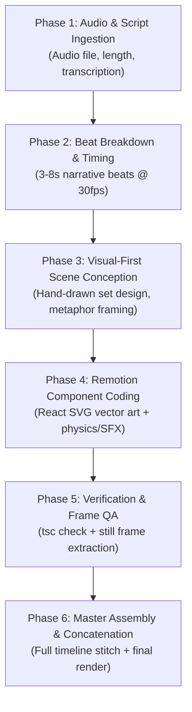

# 🎬 MAIN ANIMATION REFERENCE & PRODUCTION PROCEDURE

> **Project**: BlokeTuber / Mosquito Magnet Animation System  
> **Benchmark Reference**: [Why Do Mosquitoes Always Bite You? (YouTube)](https://www.youtube.com/watch?v=U-QW-HkDOmA)  
> **Aesthetic Style**: Zenn Hand-Drawn Comic Stickman Animation  
> **Engine**: Remotion (React + TypeScript + SVG Vector Graphics @ 1920x1080 30fps)

---

## 📌 Table of Contents
1. [Core Benchmark & Visual Target](#1-core-benchmark--visual-target)
2. [All User Instructions & Directives (Canonical Rules)](#2-all-user-instructions--directives-canonical-rules)
   - [Visual Fidelity & Hand-Drawn Environments](#visual-fidelity--hand-drawn-environments)
   - [Text & Typography Rules (Anti-Text-Heavy)](#text--typography-rules-anti-text-heavy)
   - [Text Padding & Border Safety System](#text-padding--border-safety-system)
   - [Audio & Music Directives](#audio--music-directives)
   - [Character & Asset Anatomy](#character--asset-anatomy)
3. [The End-to-End Production Procedure](#3-the-end-to-end-production-procedure)
   - [Phase 1: Audio & Script Ingestion](#phase-1-audio--script-ingestion)
   - [Phase 2: Narrative Beat Breakdown & Timing](#phase-2-narrative-beat-breakdown--timing)
   - [Phase 3: Visual-First Scene Composition](#phase-3-visual-first-scene-composition)
   - [Phase 4: Component Implementation & Motion Physics](#phase-4-component-implementation--motion-physics)
   - [Phase 5: Automated Verification & Frame QA](#phase-5-automated-verification--frame-qa)
   - [Phase 6: Master Assembly & Final Concatenation](#phase-6-master-assembly--final-concatenation)
4. [Component Architecture & Directory Map](#4-component-architecture--directory-map)
5. [Checklist for Incoming New Script & Audio](#5-checklist-for-incoming-new-script--audio)

---

## 1. Core Benchmark & Visual Target

The animation quality is strictly benchmarked against the reference video:
- **Reference Video**: [https://www.youtube.com/watch?v=U-QW-HkDOmA](https://www.youtube.com/watch?v=U-QW-HkDOmA) (*"Why Do Mosquitoes Always Bite You ?"*)
- **Visual Essence**:
  - **Hand-drawn Comic Aesthetic**: Dynamic, organic black ink outlines (`strokeWidth` 3.5 to 7px), expressive character faces, cartoon exaggeration.
  - **Visual Storytelling Over Words**: Concepts are explained through **actions, diagrams, visual metaphors, and environmental dynamics**, not blocks of explanatory text.
  - **No Flat Voids**: Backgrounds always feature styled skies, grass horizons, interior walls, wood flooring, trees, clouds, or laboratory desks.

---

## 2. All User Instructions & Directives (Canonical Rules)

Throughout project iterations, the user provided explicit guidelines that govern all animation work:

### Visual Fidelity & Hand-Drawn Environments
1. **Never use plain white or blank backgrounds**:
   - Every frame must feature an environmental context (e.g., sky + grass line, warm interior living room, night sky with glowing moon, laboratory desk with test tubes, outdoor patio with blazing sun).
2. **Dynamic Visual Metaphors**:
   - Rather than just talking about CO2, visualize physical undulating breath clouds with glowing breadcrumbs.
   - For chemical sensors, render vibrating antenna arrays with radar sweep rings and target pings.
   - For thermal contrast, show radiating crimson heatwaves vs cool cyan reflections.

### Text & Typography Rules (Anti-Text-Heavy)
1. **Strictly NOT text-heavy**:
   - The reference video contains virtually NO paragraphs or explanatory subtitles inside the artwork.
   - Visuals carry 90% of the information; text only provides punchy comic emphasis (e.g., `CO₂`, `50m`, `NOT RANDOM ❌`, `+21%`, `85% GENETIC`).
2. **NO corporate cards or generic badges**:
   - Ban all corporate SaaS-style info cards (`StoryBadge`, glassmorphic cards, standard software UI pill shapes).
   - Use organic comic callout bubbles, hand-drawn paper notes, chalkboards, or wooden road signs.

### Text Padding & Border Safety System
1. **Generous Horizontal & Vertical Padding**:
   - **Problem addressed**: Text labels previously hugged or touched the borders of pill containers (e.g., at 1m 14s for `CHEMISTRY RADAR 📡` and at 3m 6s for `DARK SHIRT: HEAT TRAP! 🔥`).
   - **Rule**: Every text container must have a minimum of **40px–60px horizontal safety padding** on both sides (`width >= textPixelWidth + 80px`).
   - Use centered coordinates with `textAnchor="middle"` and conservative font sizes (18px–22px) so text breathes freely inside its boundary box without touching borders.

### Audio & Music Directives
1. **NO Background Music (BGM)**:
   - User directive: *"Remove bg music at all"*.
   - All background music loops (e.g., `sneaky_snitch.mp3`) are completely removed from `MosquitoMasterVideo.tsx`.
2. **Pure Voiceover + Crisp SFX**:
   - Audio consists exclusively of crystal-clear voiceover narration synced to snappy, organic sound effects (`whoosh_air`, `subtle_hit`, `pop`, `ding`, `chime`).
   - Sound effects must align directly with visual arrivals, stamp impacts, and transitions.

### Character & Asset Anatomy
1. **The Protagonist (Mosquito Magnet Host)**:
   - Stickman with 3 distinct spiky hairs on head.
   - Expressive comic face: wide panic eyes, drooping sweat drops, open screaming mouth when swarmed.
   - Raised red welts (`#EF4444`) on arms, cheeks, and legs with pulsing scratch marks.
2. **The Confident Friend**:
   - Stickman with round spectacles/glasses, cool composed smile, zero mosquito bites.
3. **The Female Mosquito Villain**:
   - Sharp hypodermic needle proboscis, segmented black/grey striped abdomen, 6 jointed spindly legs, translucent fluttering wings with sine-wave motion blur.

---

## 3. The End-to-End Production Procedure

We follow a disciplined 6-phase pipeline to transform raw audio and scripts into polished video:



### Phase 1: Audio & Script Ingestion
- Place narration MP3 files into `packages/remotion-video/public/audio/`.
- Measure exact audio durations via `ffprobe` / Node script to get the exact frame count at 30 fps (`durationInFrames = Math.ceil(seconds * 30)`).

### Phase 2: Narrative Beat Breakdown & Timing
- Decompose each chapter into sequential narrative "beats" (typically 3 to 8 seconds each).
- Record exact start and end frame markers matching spoken sentences.
- Ensure every single beat introduces a fresh visual action or angle to maintain rapid pacing.

### Phase 3: Visual-First Scene Conception
- For each beat, define:
  1. **Setting / Background**: Ground plane, horizon, time-of-day color palette.
  2. **Active Characters**: Host, friend, mosquito, scientist, or crowd.
  3. **Visual Metaphor / Graphic Focus**: Scent trails, magnifiers, radar sweeps, split screens, thermal maps.
  4. **Minimal Comic Label**: Punchy 1–3 word hand-drawn sign (if needed).

### Phase 4: Component Implementation & Motion Physics
- Write modular React SVG components in `packages/remotion-video/src/mosquito/shared/`.
- Use Remotion animation hooks:
  - `useCurrentFrame()`: Frame-based timing.
  - `spring()`: Organic overshoot and bounce on character entrances.
  - `interpolate()`: Smooth linear/curved transitions between coordinates.
  - `Math.sin(frame * freq)`: Wing flutters, floating sweat drops, heat shimmer, breathing plumes.
- Attach synchronized `SfxTrigger` events on beat entrances and visual reveals.

### Phase 5: Automated Verification & Frame QA
- **Type Safety**: Execute `npx tsc --noEmit` to guarantee 0 compiler errors.
- **Still Frame Capture**: Use Remotion still render scripts to export JPEG snapshots at key timestamps (e.g. 10s, 30s, 65s, 90s, 180s).
- **Inspection**: Review snapshots to ensure:
  - Text is not clipping container borders.
  - No plain white backgrounds exist.
  - Vector lines and characters are cleanly aligned.

### Phase 6: Master Assembly & Concatenation
- Sequence chapters back-to-back inside `MosquitoMasterVideo.tsx`.
- Keep audio purely on the voiceover tracks and SFX (no background music).
- Render via `apps/api/scripts/render_mosquito_master.ts` to output clean 1080p MP4.

---

## 4. Component Architecture & Directory Map

```
packages/remotion-video/src/mosquito/
├── MosquitoMasterVideo.tsx         # Master composition orchestrating all chapters sequentially
├── chapters/
│   ├── Chapter0_Hook.tsx           # Chapter 0: The Mosquito Magnet Dilemma (49.08s)
│   ├── Chapter1_NotGuessing.tsx    # Chapter 1: She's Not Guessing — Radar & CO2 (63.06s)
│   ├── Chapter2_Skin.tsx           # Chapter 2: What Your Skin Is Saying (89.21s)
│   ├── Chapter3_WhyMatters.tsx     # Chapter 3: Why This Actually Matters (74.40s)
│   ├── Chapter4_TwinStudy.tsx      # Chapter 4: The 85% Genetic Twin Study (64.63s)
│   └── Chapter5_Closing.tsx        # Chapter 5: What Works vs What's Myth (56.61s)
└── shared/
    ├── ZennStyle.tsx               # Core stickman bodies, comic heads, expressions, color constants
    ├── ZennMasterComponents.tsx    # Hook scene components & environments
    ├── ZennChapter1Components.tsx  # CO2 plumes, radar HUD, soccer field scale
    ├── ZennSkinScenes.tsx          # Microscope skin flora, sweat traps, shirt contrast
    ├── ZennChapter3Components.tsx  # Historical disease vectors, yellow fever, global map
    ├── Chapter4MasterComponents.tsx# Identical vs fraternal twin tests, Y-tube olfactometer
    ├── ZennClosingComponents.tsx   # DEET forcefield, myths cross-out, final signoff
    └── MosquitoElements.tsx        # Audio triggers and sound effect system
```

---

## 5. Checklist for Incoming New Script & Audio

When the user provides the new script and audio files, follow this checklist immediately:

- [ ] **1. Audio Placement**: Save new voiceover audio files into `packages/remotion-video/public/audio/mosquito/` with clean naming.
- [ ] **2. Exact Duration Calculation**: Calculate exact frame lengths (`seconds * 30`) and update chapter frame constants in `MosquitoMasterVideo.tsx`.
- [ ] **3. Beat Script Alignment**: Map script lines to specific beat timestamps with visual action descriptions.
- [ ] **4. Build / Update Scene Components**:
  - Keep 100% Zenn hand-drawn comic style.
  - Zero plain white voids.
  - Minimal text with >=40px padding on all pill boxes.
- [ ] **5. Keep Background Music Removed**: Ensure only VO + SFX play.
- [ ] **6. Run TypeScript Verification**: Run `npx tsc --noEmit` to ensure 0 errors.
- [ ] **7. Await User Approval / Render Request**: Confirm code and scenes are ready, then render upon user instruction.
